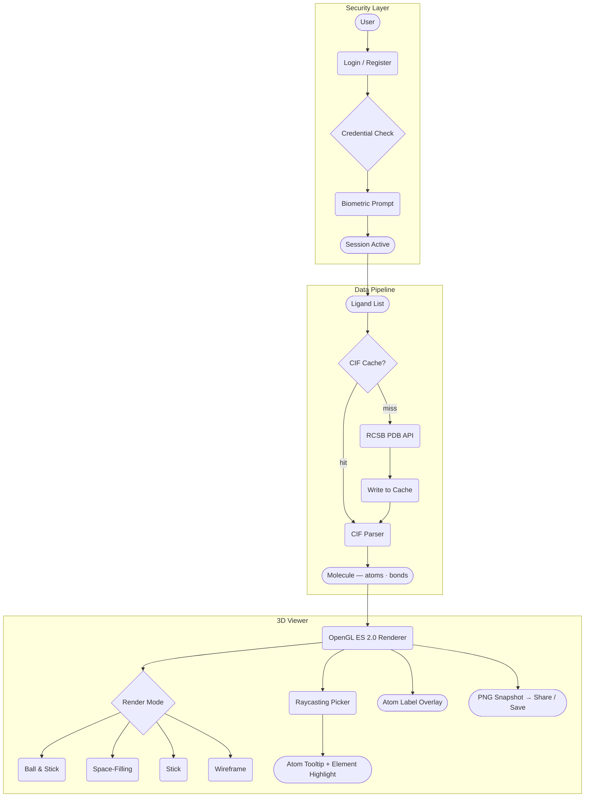

_This project has been created as part of the 42 curriculum by nadoho._

## Description

**Swifty Proteins** is an Android application that lets users explore the 3D atomic structure of chemical ligands sourced from the [RCSB Protein Data Bank](https://www.rcsb.org/). After a secure authentication step, users browse a curated list of ligand identifiers, fetch their CIF data on demand, and visualize the resulting molecule through an interactive OpenGL ES 2.0 renderer. The viewer supports four render modes, real-time atom selection with element highlighting, an atom-label overlay, and a one-tap share flow that captures the current 3D frame.

```mermaid
graph LR
    classDef blueNode  fill:#e8f0fe,stroke:#8ab4f8,stroke-width:1px,color:#000
    classDef greenNode fill:#e6f4ea,stroke:#81c995,stroke-width:1px,color:#000
    classDef peachNode fill:#fce8e6,stroke:#f28b82,stroke-width:1px,color:#000
    classDef pinkNode  fill:#f3e8fd,stroke:#c58af9,stroke-width:1px,color:#000
    classDef purpleNode fill:#e8eaf6,stroke:#9fa8da,stroke-width:1px,color:#000

    style Auth    fill:none,stroke:#9aa0a6,stroke-width:1px,stroke-dasharray:5 5
    style Render  fill:none,stroke:#9aa0a6,stroke-width:1px,stroke-dasharray:5 5

    subgraph Auth ["Authentication"]
        Login("Login / Register"):::blueNode
        Biometric("Biometric Prompt"):::blueNode
        Login --> Biometric
    end

    LigandList("Ligand List<br>(search · favorites)"):::greenNode
    Biometric --> LigandList

    subgraph Render ["Data & Rendering"]
        Fetch("Fetch CIF<br>(RCSB PDB API)"):::peachNode
        Cache("Local CIF Cache"):::peachNode
        Parse("CIF Parser<br>(atoms · bonds)"):::peachNode
        GL("OpenGL ES 2.0<br>Renderer"):::pinkNode
        Fetch --> Cache --> Parse --> GL
    end

    LigandList --> Fetch

    Share("Share / Save<br>(PNG snapshot)"):::purpleNode
    GL -. "screenshot" .-> Share
```



## Instructions

> [!NOTE]
> For environment setup (JDK, Android SDK, udev rules, environment variables), refer to the [dedicated documentation](assets/man/prj-setup.md).

### Build

```bash
git clone <repo-url> swifty-proteins
cd swifty-proteins
./gradlew assembleDebug
```

### Install

```bash
# Physical device or running emulator
adb install app/build/outputs/apk/debug/app-debug.apk
```

### First launch

1. **Register** a username and password (minimum 4 characters).
2. **Log in** with credentials or use biometrics if enrolled on the device.
3. Browse or **search** the ligand list; tap ★ to add a favorite.
4. Tap a ligand name to fetch and render its 3D structure.
5. In the viewer — rotate with one finger, pinch to zoom, two-finger pan.
6. **Tap an atom** to inspect its element, ID, and XYZ coordinates.
7. Use the toolbar to toggle labels, switch render mode, reset the camera, or share a snapshot.

## System architecture



## Authentication strategy

Access to the app is gated behind a credential system backed by `EncryptedSharedPreferences` (AndroidX Security Crypto). On first launch the user creates a username and password (≥ 4 characters); subsequent launches offer biometric authentication (fingerprint or face) auto-prompted when the hardware is ready. The session is locked automatically whenever the app is sent to the background, redirecting back to the login screen on next resume.

## Data pipeline

Ligand identifiers are loaded at startup from a bundled `ligands.txt` asset. When a user selects a ligand, the app first checks a local CIF file cache; on a miss it fetches the record from the RCSB PDB REST API via Retrofit, writes it to the cache, then hands the raw CIF text to the parser. The CIF parser walks the file line-by-line, identifies the `_chem_comp_atom` and `_chem_comp_bond` loop blocks, extracts column headers dynamically, and builds a `Molecule` object from the parsed atom coordinates and bond connectivity.

## Rendering approach

The 3D viewer is built on a custom OpenGL ES 2.0 renderer. Atoms are drawn as UV spheres (20 stacks × 20 slices) using a Phong shading model (ambient + diffuse + specular with a Blinn-Halfway vector). Bonds are rendered as cylinders (16 segments) aligned along each atom pair's direction vector via an axis-angle rotation from the default Z-axis. Four render modes are available:

| Mode | Description |
|---|---|
| **Ball & Stick** | CPK-colored spheres + gray cylindrical bonds |
| **Space-Filling** | Spheres scaled to van der Waals radii |
| **Stick** | Wider bond cylinders with small atom end-caps |
| **Wireframe** | Flat cyan edge lines via a lightweight wire shader |

Atom selection uses a 3D ray cast from the touch point through the view frustum, testing against each atom's bounding sphere. A selected atom receives a translucent cyan halo; every other atom sharing the same element symbol gets a gold halo.

## Performance & caching

Downloaded CIF records are written to the app's internal storage, keyed by ligand ID. Subsequent visits resolve in milliseconds without touching the network. The molecule centroid and bounding radius are computed once on load to auto-fit the camera; the initial distance is set to `boundingRadius × 3.2`. Wireframe geometry is pre-built into a static `FloatBuffer` on molecule load to avoid per-frame allocation.

## Bonuses

📂 [Atom label overlay](assets/man/atom_label_overlay.md)

📂 [Element highlighting](assets/man/element_highlighting.md)

📂 [Share & save to photo album](assets/man/share_save.md)

📂 [CIF incremental cache](assets/man/cif_cache.md)

## Resources

- [RCSB Protein Data Bank](https://www.rcsb.org/) — source of all CIF ligand records
- [CIF format (IUCr)](https://www.iucr.org/resources/cif) — crystallographic information file specification
- [CPK coloring (Wikipedia)](https://en.wikipedia.org/wiki/CPK_coloring) — element-based atom color convention
- [BM25 van der Waals radii (Wikipedia)](https://en.wikipedia.org/wiki/Van_der_Waals_radius)
- [OpenGL ES 2.0 reference (Khronos)](https://www.khronos.org/opengles/sdk/docs/man/)
- [Phong reflection model (Wikipedia)](https://en.wikipedia.org/wiki/Phong_reflection_model)
- [Möller–Trumbore intersection (Wikipedia)](https://en.wikipedia.org/wiki/M%C3%B6ller%E2%80%93Trumbore_intersection_algorithm) — basis for the raycasting picker
- [AndroidX Biometric](https://developer.android.com/jetpack/androidx/releases/biometric)
- [AndroidX Security Crypto](https://developer.android.com/jetpack/androidx/releases/security)
- [Retrofit (Square)](https://square.github.io/retrofit/)

### AI Usage

- Project research and architecture planning
- Debugging the OpenGL ES cylinder transform and raycasting logic
- Code quality audit
- Writing documentation and this README
