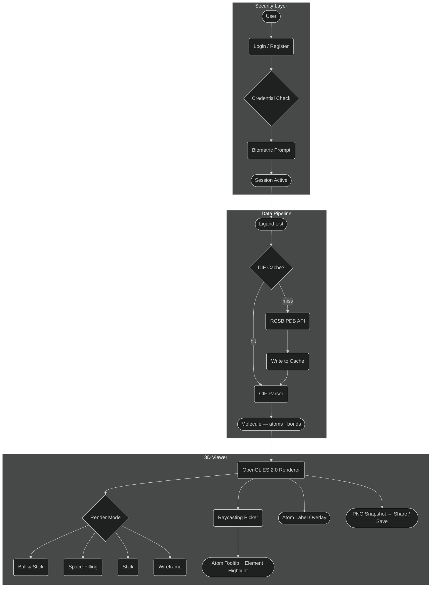

## Description

**Swifty Proteins** is an Android application that lets users explore the 3D atomic structure of chemical ligands sourced from the [RCSB Protein Data Bank](https://www.rcsb.org/). After a secure authentication step, users browse a curated list of ligand identifiers, fetch their CIF data on demand, and visualize the resulting molecule through an interactive OpenGL ES 2.0 renderer. The viewer supports four render modes, real-time atom selection with element highlighting, an atom-label overlay, and a one-tap share flow that captures the current 3D frame.

```mermaid
%%{init: {'theme': 'dark'}}%%
graph LR
    classDef blueNode  fill:#1a2744,stroke:#8ab4f8,stroke-width:1px,color:#e8f0fe
    classDef greenNode fill:#1a3028,stroke:#81c995,stroke-width:1px,color:#e6f4ea
    classDef peachNode fill:#3a1f1d,stroke:#f28b82,stroke-width:1px,color:#fce8e6
    classDef pinkNode  fill:#2d1f3d,stroke:#c58af9,stroke-width:1px,color:#f3e8fd
    classDef purpleNode fill:#1f2240,stroke:#9fa8da,stroke-width:1px,color:#e8eaf6

    style Auth    fill:none,stroke:#9aa0a6,stroke-width:1px,stroke-dasharray:5 5
    style Render  fill:none,stroke:#9aa0a6,stroke-width:1px,stroke-dasharray:5 5

    subgraph Auth ["Authentication"]
        Login("Login / Register"):::blueNode
        Biometric("Biometric Prompt"):::blueNode
        Login --> Biometric
    end

    LigandList("Ligand List<br>(search · favorites)"):::greenNode
    Biometric --> LigandList

    subgraph Render ["Data & Rendering"]
        Fetch("Fetch CIF<br>(RCSB PDB API)"):::peachNode
        Cache("Local CIF Cache"):::peachNode
        Parse("CIF Parser<br>(atoms · bonds)"):::peachNode
        GL("OpenGL ES 2.0<br>Renderer"):::pinkNode
        Fetch --> Cache --> Parse --> GL
    end

    LigandList --> Fetch

    Share("Share / Save<br>(PNG snapshot)"):::purpleNode
    GL -. "screenshot" .-> Share
```



>[!NOTE]
>A **ligand** is a molecule or ion that binds to another molecule or atom—most commonly a central metal atom in chemistry, or a receptor protein in biology. The term comes from the Latin _ligare_, meaning "to bind". In biology, **ligands bind directly to specific pockets on proteins to turn them on, turn them off, or trigger a cellular action**. Because proteins do most of the mechanical and chemical work inside a cell, ligands act as the "keys" or signals that control when and how those proteins operate.

## Instructions

### Prerequisites
- **Java Development Kit**: JDK 17 or JDK 21
- **Android SDK**: Android API 37 platform, Build-Tools, and Platform-Tools (`adb`)
- **Device / Emulator**: Android 8.0+ (API 26+) physical device with USB debugging enabled, or an Android Virtual Device (AVD) with Google Play Services (see [📂 **Android Emulator & 42 School Environment Setup**](assets/man/env-001-emulator-setup.md) for full CLI setup and `goinfre` configuration)

### Build & Compilation
```bash
# Build debug APK via Makefile
make build

# Or directly with Gradle wrapper
./gradlew assembleDebug
```

### Installation & Launch
```bash
# Build, install, and launch on active ADB target
make start

# Target an Android emulator specifically
make start-emu

# Target a USB-connected physical phone
make start-usb
```

### Quick Commands Reference
| Command | Action |
|---|---|
| `make all` / `make build` | Compile the debug APK (`app/build/outputs/apk/debug/app-debug.apk`) |
| `make emu` | Boot the Android emulator in the background if not already running |
| `make start` | Build, install, and launch cold start on default active device |
| `make start-emu` | Build, auto-boot emulator if needed, install, and launch cold start on Android emulator |
| `make start-usb` | Build, install, and launch cold start on USB physical phone |
| `make bio-success` | Simulate a valid fingerprint touch on emulator (`finger touch 1`) |
| `make bio-fail` | Simulate an unrecognized fingerprint touch on emulator (`finger touch 2`) |
| `make clear-data` | Wipe app credentials and KeyStore data for defense testing |
| `make pull-photos` | Pull exported 3D protein snapshots from device to local directory |
| `make screenshot` | Capture the current device screen |
| `make logs` | Stream filtered real-time logcat output for `com.example.swiftyproteins` |
| `make test` | Execute local unit tests |
| `make clean` / `make fclean` | Clean build cache / full reset including uninstall |

## Technical Stack

- **Core & Runtime**:
  - **Language**: Kotlin 1.9+
  - **Platform**: Android SDK (Compile & Target: `API 37`, Minimum: `API 26` Android 8.0)
  - **Concurrency**: Kotlin Coroutines (`Dispatchers.IO`, `Dispatchers.Default`, `Dispatchers.Main`)
- **Graphics & 3D Visualization**:
  - **Engine**: Custom Native OpenGL ES 2.0 Pipeline
  - **Shaders**: GLSL vertex and fragment shaders implementing the **Phong reflection model** (ambient, diffuse, specular highlights)
  - **Geometry**: Direct native FloatBuffers for tessellated UV spheres (`SphereMesh`) and orientation-transformed cylinders (`CylinderMesh`)
  - **Interaction**: 3D Raycasting picker (`RaycastPicker`) with inverted Model-View-Projection NDC unprojection
- **Security & Storage**:
  - **Biometrics**: AndroidX `BiometricPrompt` & `BiometricManager` (Class 3 / Class 2 authenticators)
  - **Hardware KeyStore**: `MasterKey` AES256_GCM hardware-backed key scheme
  - **Encrypted Preferences**: `EncryptedSharedPreferences` (`AES256_SIV` key encryption, `AES256_GCM` value encryption)
  - **Password Hashing**: `SecureRandom` 16-byte cryptographically secure pseudo-random salt + `SHA-256` hashing
  - **Lifecycle Security**: `ProcessLifecycleOwner` monitoring for automatic background session locking
- **Networking & Data Pipeline**:
  - **Network Client**: Square Retrofit 2.9.0 & OkHttp 3 with logging interceptors and 15s timeout
  - **Remote Source**: [RCSB Protein Data Bank](https://www.rcsb.org/) REST API (`https://files.rcsb.org/ligands/view/{ligand}.cif`)
  - **CIF Parser**: Custom tokenizer parsing `_chem_comp_atom` coordinates and `_chem_comp_bond` connections
  - **Local Cache**: Persistent on-disk CIF caching (`filesDir/cif_cache/`)
- **User Interface & Architecture**:
  - **Architecture**: Android Jetpack, ViewBinding, Material Components
  - **Layouts**: Responsive `ConstraintLayout` adapting across screen sizes and orientations
  - **Sharing**: Scoped storage compliant `MediaStore` API + `FileProvider` (`Intent.ACTION_SEND`)

## System architecture



## Features

Detailed documentation for each feature, including implementation architecture, codebase references, and step-by-step testing guides, is located in [`assets/man/`](assets/man/) (indexed in [`assets/README.md`](assets/README.md)).

### Mandatory

* [📂 **Application Icon and Launch Screen**](assets/man/feat-001-app-icon-and-launch-screen.md)  
  Adaptive multi-density launcher icon across all standard screen densities; dedicated splash screen with branding logo enforced to display for at least 1.0 second (`1100 ms`) with smooth fade transitions; responsive autolayout.

* [📂 **Login View**](assets/man/feat-002-login-view.md)  
  Credential registration and login; native AndroidX `BiometricPrompt` with graceful fallback and informative error dialogs; hardware-backed encryption via KeyStore `MasterKey` (AES-256) and salted SHA-256 hashing; process-wide background auto-lock.

* [📂 **Protein List View**](assets/man/feat-003-protein-list-view.md)  
  Candidate ligand loading from bundled `ligands.txt` into an optimized `RecyclerView`; real-time search filtering; asynchronous remote CIF retrieval from RCSB PDB; centered modal loading spinner; comprehensive error alert dialogs.

* [📂 **Protein View**](assets/man/feat-004-protein-view.md)  
  Custom OpenGL ES 2.0 3D renderer; Ball-and-Stick molecular geometry; standard CPK chemical coloring; touch gestures (1-finger orbit rotation, 2-finger pinch zoom, 2-finger pan); 3D raycasting atom selection with tooltip; one-tap PNG capture saving to photo album and opening system share sheet.

### Bonus

* [📂 **Multiple Visualization Models**](assets/man/bonus-001-multiple-visualization-models.md)  
  Dynamic in-place switching between Ball & Stick, Space-Filling (empirical Van der Waals radii), Stick (Licorice), and Wireframe line primitives without reloading or re-fetching data; adaptive raycast picking.

* [📂 **Advanced User Interface**](assets/man/bonus-002-advanced-user-interface.md)  
  Custom elevated card list cells with molecular ring avatars and offline cache pills; activity fade transitions; OLED-optimized dark mode color palette; contextual toolbars for camera reset, model toggle, and label overlay.

* [📂 **Enhanced Molecular Interactions**](assets/man/bonus-003-enhanced-molecular-interactions.md)  
  Dual-layer atom highlighting (cyan selection halo and gold element-wide co-highlighting); floating 3D-projected CPK atom labels overlay; automated Hill notation empirical formula computation (`Molecule.molecularFormula`); camera reset.

* [📂 **Performance and Caching**](assets/man/bonus-004-performance-and-caching.md)  
  Persistent on-disk CIF caching enabling instant offline access; lazy loading; multi-threaded coroutine parsing (`Dispatchers.IO` and `Dispatchers.Default`); zero-allocation render loop using native ByteBuffers; unthrottled 60–120 FPS rendering with frame pacing.

* [📂 **Extended Sharing and Export**](assets/man/bonus-005-extended-sharing-and-export.md)  
  Custom formatted share messages with Hill formula and atom/bond counts; Scoped Storage `MediaStore` photo album export (`Pictures/SwiftyProteins`); Android `FileProvider` system share sheet integration; persistent favorites bookmarking system.

## Resources

- [RCSB Protein Data Bank](https://www.rcsb.org/) — source of all CIF ligand records
- [CIF format (IUCr)](https://www.iucr.org/resources/cif) — crystallographic information file specification
- [CPK coloring (Wikipedia)](https://en.wikipedia.org/wiki/CPK_coloring) — element-based atom color convention
- [BM25 van der Waals radii (Wikipedia)](https://en.wikipedia.org/wiki/Van_der_Waals_radius)
- [OpenGL ES 2.0 reference (Khronos)](https://www.khronos.org/opengles/sdk/docs/man/)
- [Phong reflection model (Wikipedia)](https://en.wikipedia.org/wiki/Phong_reflection_model)
- [Möller–Trumbore intersection (Wikipedia)](https://en.wikipedia.org/wiki/M%C3%B6ller%E2%80%93Trumbore_intersection_algorithm) — basis for the raycasting picker
- [AndroidX Biometric](https://developer.android.com/jetpack/androidx/releases/biometric)
- [AndroidX Security Crypto](https://developer.android.com/jetpack/androidx/releases/security)
- [Retrofit (Square)](https://square.github.io/retrofit/)

### AI Usage

Artificial Intelligence assistance tools were utilized throughout the project lifecycle in the following capacities:

- Project research and architecture planning
- Debugging the OpenGL ES cylinder transform and raycasting logic
- Code quality audit
- Writing documentation and this README

> [!NOTE]
>
> All code, architecture designs, documentation, and configurations generated or refined with AI assistance were comprehensively audited, reviewed, verified, and tested by human team members to guarantee correctness, maintainability, and full adherence to project guidelines and academic integrity standards.
