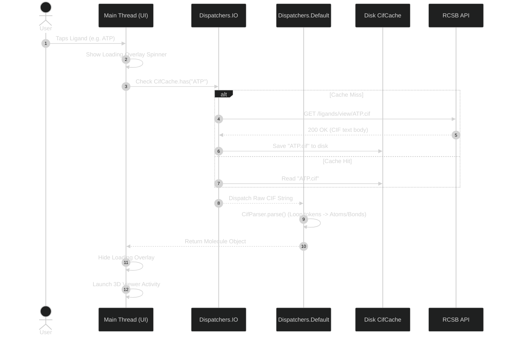

# Performance and Caching

## Overview

The **Performance and Caching** bonus feature focuses on optimizing application responsiveness, minimizing network bandwidth consumption, and ensuring a fluid 60+ FPS OpenGL rendering pipeline. It implements persistent on-device CIF file caching, on-demand lazy loading, coroutine-based background thread parsing, and zero-allocation memory practices in the graphics loop.

---

## Technical Specifications

### 1. Local Caching (`CifCache`)
- **Persistent Disk Storage**: Downloaded CIF files are stored in the internal app storage sandbox under `context.filesDir/cif_cache/{LIGAND}.cif`.
- **Cache-First Strategy**:
  When a user taps a ligand in the catalog, `CifCache.has(context, id)` checks local storage first:
  - **Cache Hit**: Content is read directly from disk in milliseconds, completely bypassing the network.
  - **Cache Miss**: Fetched from RCSB PDB over HTTPS and immediately committed to disk for subsequent access.
- **Visual Status Indicator**: Ligands available in local cache display a bright green `CACHED` badge in the catalog list (`bg_badge_cached.xml`).

### 2. Lazy Loading Architecture
- Instead of pre-fetching or bulk-downloading the entire catalog of ligands listed in `ligands.txt` (which would consume excessive bandwidth and memory), structures are downloaded strictly on demand.
- The `RecyclerView` maintains minimal memory footprint by recycling item view holders during scrolling.

### 3. Background Multi-Thread Parsing
All heavy operations are strictly offloaded from the Android UI Main thread using **Kotlin Coroutines**:



### 4. Memory Management & Zero-Allocation Graphics Loop
- **Direct Native ByteBuffers**:
  Vertex coordinates and normals for `SphereMesh`, `CylinderMesh`, and `wireframeBuffer` use direct native ByteBuffers (`ByteBuffer.allocateDirect().order(ByteOrder.nativeOrder())`). This prevents JVM garbage collection pressure.
- **Pre-Allocated Transformation Matrices**:
  All transformation matrices (`modelMatrix`, `viewMatrix`, `projectionMatrix`, `mvpMatrix`, `mvMatrix`, `tempMatrix`) are allocated once as static float arrays in `ProteinRenderer` and updated in place. No object instantiations occur inside `onDrawFrame()`.
- **Singleton Data Transfer (`MoleculeHolder`)**:
  Passing large molecular graphs (hundreds of atoms and bonds) between `ProteinListActivity` and `ProteinViewerActivity` via standard `Intent.putExtra()` would require heavy Parcelable serialization, risking `TransactionTooLargeException`. `MoleculeHolder` passes the parsed model via an in-memory singleton reference, achieving instantaneous transitions.

### 5. 60 FPS Rendering Guarantee
- **Continuous Frame Synchronization**: `GLSurfaceView.RENDERMODE_CONTINUOUSLY` locks render passes to the display's hardware VSync refresh rate (60 Hz / 120 Hz).
- **GPU Backface Culling**: `GLES20.glEnable(GLES20.GL_CULL_FACE)` with `GLES20.GL_BACK` eliminates half of all rasterized sphere and cylinder fragments before shading.
- **Hardware Depth Testing**: `GLES20.glEnable(GLES20.GL_DEPTH_TEST)` with `GL_LEQUAL` guarantees correct occlusion of back-facing atoms.

---

## Relevant Files in the Codebase

| File | Type | Description |
|---|---|---|
| [`CifCache.kt`](file:///home/firstmate/GitHub/swifty-proteins/app/src/main/java/com/example/swiftyproteins/data/cache/CifCache.kt) | Kotlin Source | Internal disk cache manager writing and reading CIF files under `cif_cache/`. |
| [`CifParser.kt`](file:///home/firstmate/GitHub/swifty-proteins/app/src/main/java/com/example/swiftyproteins/data/parser/CifParser.kt) | Kotlin Source | Tokenizer and coordinate extractor executed on `Dispatchers.Default`. |
| [`ProteinListActivity.kt`](file:///home/firstmate/GitHub/swifty-proteins/app/src/main/java/com/example/swiftyproteins/ui/protein/ProteinListActivity.kt) | Kotlin Source | Coordinates coroutine scopes (`Dispatchers.IO` and `Dispatchers.Default`). |
| [`MoleculeHolder.kt`](file:///home/firstmate/GitHub/swifty-proteins/app/src/main/java/com/example/swiftyproteins/data/model/MoleculeHolder.kt) | Kotlin Source | In-memory singleton providing zero-copy molecule transfer across activities. |
| [`ProteinRenderer.kt`](file:///home/firstmate/GitHub/swifty-proteins/app/src/main/java/com/example/swiftyproteins/ui/viewer/gl/ProteinRenderer.kt) | Kotlin Source | Pre-allocated matrix engine and VSync rendering loop. |
| [`SphereMesh.kt`](file:///home/firstmate/GitHub/swifty-proteins/app/src/main/java/com/example/swiftyproteins/ui/viewer/gl/SphereMesh.kt) | Kotlin Source | Pre-computed direct native FloatBuffer containing sphere vertices and normals. |
| [`CylinderMesh.kt`](file:///home/firstmate/GitHub/swifty-proteins/app/src/main/java/com/example/swiftyproteins/ui/viewer/gl/CylinderMesh.kt) | Kotlin Source | Pre-computed direct native FloatBuffer containing cylinder vertices and normals. |

---

## Testing and Verification

### 1. Manual Evaluation Scenarios

#### Scenario A: Disk Caching Verification
1. Open an uncached ligand (e.g. `HEM`). Notice the `"Fetching HEM from RCSB..."` loading spinner.
2. Return to `ProteinListActivity`.
3. Notice that `HEM` now displays a green **`CACHED`** badge on its list card.
4. Tap `HEM` again.
5. Notice that it opens virtually instantaneously with `"Loading HEM..."` from cache, without any network round-trip.

#### Scenario B: Offline Verification of Cached Molecules
1. Cache 2–3 molecules by opening them once.
2. Turn on **Airplane Mode** (completely disabling Wi-Fi and mobile data).
3. Tap one of the cached molecules.
4. Confirm that the cached molecule loads and renders immediately in full 3D without errors.

#### Scenario C: Frame Rate Stability Under Interaction
1. Open a complex ligand with dozens of atoms (e.g. `NAG`, `FAD`, or `ATP`).
2. Rapidly rotate and zoom the molecule continuously for 15 seconds.
3. Confirm that motion remains fluid without frame stutter or lag.

### 2. ADB Profiling Commands

```bash
# Verify cached files on device internal storage
adb shell run-as com.example.swiftyproteins ls -lh /data/data/com.example.swiftyproteins/files/cif_cache/

# Profile GPU rendering and frame drops (target: < 16.6ms per frame for 60 FPS)
adb shell dumpsys gfxinfo com.example.swiftyproteins framestats
```

### 3. Evaluation Checklist Alignment
- [x] Downloaded CIF files are cached persistently on disk.
- [x] Cached entries load instantaneously and work while offline.
- [x] Heavy parsing and networking are executed in background coroutines.
- [x] Memory allocations in the OpenGL render loop are minimized to eliminate GC stutter.
- [x] Consistent 60+ FPS rendering during rotation and scaling gestures.
