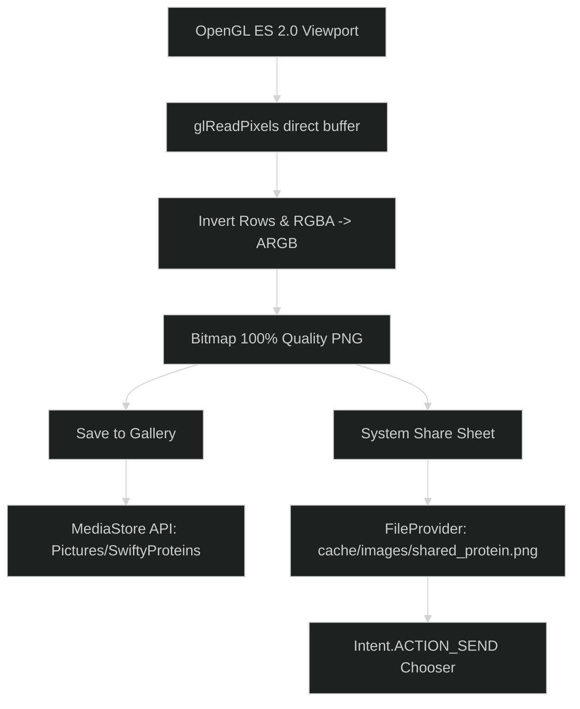

# Extended Sharing and Export

## Overview

The **Extended Sharing and Export** bonus feature enhances the application's export capabilities with formatted scientific share messages, high-resolution direct-to-gallery rendering export, system share sheet integration via Android `FileProvider`, and a persistent **Favorites System** allowing users to bookmark and filter essential ligands.

---

## Feature Specifications

### 1. Custom Share Messages
When exporting a molecule from the 3D viewer, the share payload is automatically enriched with structured scientific metadata generated dynamically from the parsed `Molecule`:
```text
🔬 Ligand: ATP
Formula: C10H16N5O13P3
Structure: 47 atoms · 49 bonds

Rendered with Swifty Proteins — RCSB PDB
```
- **Hill Chemical Notation**: Displays carbon and hydrogen first followed by remaining elements in alphabetical order.
- **Stoichiometry Counts**: Provides verified atom and bond numbers matching the active rendering.
- **Attribution**: References the RCSB Protein Data Bank source.

### 2. Multiple Export Destinations & Formats



- **Direct Framebuffer Capture**: `GLES20.glReadPixels()` grabs the exact viewport pixels rendered by the GPU at native device resolution.
- **MediaStore Photo Album Export**:
  - Automatically writes the PNG snapshot directly into the device photo gallery under the dedicated album `Pictures/SwiftyProteins/`.
  - Fully compliant with modern Android Scoped Storage (`MediaStore.Images.Media` with `IS_PENDING` flags on Android 10+).
- **System Share Sheet Integration**:
  - Cached securely in `context.cacheDir/images/` and exposed via `androidx.core.content.FileProvider`.
  - Dispatches `Intent.ACTION_SEND` with `FLAG_GRANT_READ_URI_PERMISSION`, allowing users to send the high-res render to Gmail, Slack, Drive, WhatsApp, or Bluetooth.

### 3. Screen & Video Recording Workflows
- The app supports direct high-definition hardware screen recording during continuous 3D rotation and zooming via standard Android tools and ADB utilities:
  ```bash
  adb shell screenrecord --bit-rate 6000000 /sdcard/swifty_proteins_demo.mp4
  ```

### 4. Favorites System (`FavoritesManager`)
- **Persistent Bookmarking**: `FavoritesManager.kt` stores favorited ligand IDs in private `SharedPreferences` (`swifty_favorites`).
- **Quick-Action Toggle**: Users can favorite or un-favorite ligands directly from the catalog card list using the star icon (`ic_star_filled` / `ic_star_outline`) without having to load the 3D viewer first.
- **Catalog Filter Mode**:
  - Tapping the **Star Filter** button (`btnFavoritesFilter`) in the catalog header filters the `RecyclerView` in real time to show **only favorited molecules**.
  - Combining search queries with the favorites filter lets users search exclusively within their bookmarks.

### 5. Comparative Structural Analysis
- Standardized camera defaults and Hill notation facilitate side-by-side comparative inspection between related chemical ligands (e.g. comparing `ATP`, `ADP`, and `AMP`).
- Users can toggle between structural representations (Ball & Stick vs. Space-Filling) to evaluate comparative steric volume and bond geometry.

---

## Relevant Files in the Codebase

| File | Type | Description |
|---|---|---|
| [`ProteinViewerActivity.kt`](file:///home/firstmate/GitHub/swifty-proteins/app/src/main/java/com/example/swiftyproteins/ui/viewer/ProteinViewerActivity.kt) | Kotlin Source | Coordinates `saveToPhotoAlbum`, `shareBitmap`, `FileProvider` URI generation, and `Intent.ACTION_SEND`. |
| [`FavoritesManager.kt`](file:///home/firstmate/GitHub/swifty-proteins/app/src/main/java/com/example/swiftyproteins/data/favorites/FavoritesManager.kt) | Kotlin Source | Manages persistent favorite ligand sets in `SharedPreferences`. |
| [`ProteinAdapter.kt`](file:///home/firstmate/GitHub/swifty-proteins/app/src/main/java/com/example/swiftyproteins/ui/protein/ProteinAdapter.kt) | Kotlin Source | Binds star icons, handles bookmark toggles, and filters list by favorite status. |
| [`ProteinListActivity.kt`](file:///home/firstmate/GitHub/swifty-proteins/app/src/main/java/com/example/swiftyproteins/ui/protein/ProteinListActivity.kt) | Kotlin Source | Implements toolbar favorite filter toggle button (`btnFavoritesFilter`). |
| [`file_paths.xml`](file:///home/firstmate/GitHub/swifty-proteins/app/src/main/res/xml/file_paths.xml) | XML Resource | Defines shareable cache path mapping for Android `FileProvider`. |
| [`AndroidManifest.xml`](file:///home/firstmate/GitHub/swifty-proteins/app/src/main/AndroidManifest.xml) | Manifest | Configures `androidx.core.content.FileProvider` authority `${applicationId}.fileprovider`. |

---

## Testing and Verification

### 1. Manual Evaluation Scenarios

#### Scenario A: Share Sheet & Formatted Message
1. Open any ligand (e.g. `ATP`).
2. Tap the **Share** button.
3. Verify that the Android system share sheet appears displaying:
   - Thumbnail of the 3D rendered frame.
   - Text containing `"Ligand: ATP"`, `"Formula: C10H16N5O13P3"`, and atom/bond counts.
4. Select a messaging app, email client, or "Save to Drive" and confirm the image and text transfer successfully.

#### Scenario B: Photo Album Verification
1. Open the device's native **Gallery** or **Google Photos** app.
2. Check the **Albums** or **Collections** tab.
3. Confirm that a folder named **SwiftyProteins** exists containing the newly generated PNG snapshot (`Protein_ATP_<timestamp>.png`).
4. Zoom in on the image and verify that the 3D snapshot is crisp, complete, and uncorrupted.

#### Scenario C: Favorites System Verification
1. In the protein catalog, tap the star icon next to `ATP`, `HEM`, and `NAG`.
2. Verify that the stars change to filled yellow.
3. Tap the **Star Filter** button in the top action bar.
4. Verify that the list now displays **only** the 3 starred items.
5. In the search bar, type `"HEM"`. Confirm only `HEM` is displayed.
6. Untoggle the Star Filter button. Confirm the full catalog returns.
7. Kill and restart the app. Confirm that the starred status of `ATP`, `HEM`, and `NAG` persists across restarts.

### 2. ADB / Makefile Commands

```bash
# Pull all saved in-app snapshots from device to local directory screenshots/device_gallery/
make pull-photos

# Inspect saved images directly on device
adb shell ls -la /sdcard/Pictures/SwiftyProteins/

# Record a 10-second demo video of 3D interaction
adb shell screenrecord --time-limit 10 /sdcard/swifty_demo.mp4
adb pull /sdcard/swifty_demo.mp4 ./
```

### 3. Evaluation Checklist Alignment
- [x] Snapshot of the 3D viewer is captured and exported.
- [x] Image is saved directly to the device photo album / gallery.
- [x] System share sheet is presented with formatted scientific details.
- [x] Favorites system persists starred molecules and provides filtering.
