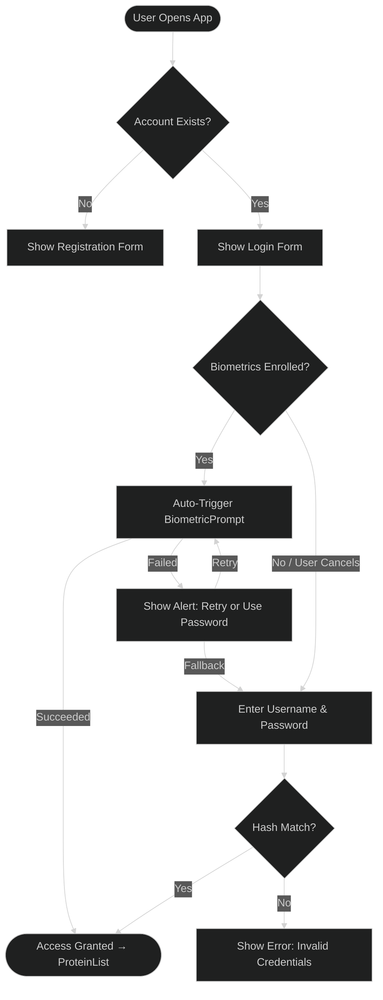

# Login View

The **Login View** provides a secure authentication gateway protecting access to the molecular exploration database. It combines standard credential-based registration and login with hardware-backed Android **Biometric Authentication** (Fingerprint and Face Unlock). The security architecture strictly forbids storing passwords in plaintext, implements zero-leakage cryptographic storage, and enforces whole-application session locking upon backgrounding.

## Authentication Architecture



## Feature Specifications

### Dual-Mode Interface (Registration & Login)
- **First Launch Detection**: When no user account has been registered, the UI automatically opens in **Registration Mode** (fields: Username, Password, Confirm Password).
- **Subsequent Launches**: Opens in **Login Mode** (fields: Username, Password) with autofill of the last active username.
- **Dynamic Mode Toggle**: Users can switch between Login and Register at any time with a single tap.
- **Input Validation**: Enforces mandatory fields, minimum password length (>= 4 characters), and confirmation match before processing.

### Native Biometric Authentication
- Implemented with AndroidX `BiometricPrompt` and `BiometricManager`.
- Supports `BIOMETRIC_STRONG` (Class 3 hardware sensors) and `BIOMETRIC_WEAK` (Class 2 sensors/Face Unlock).
- **Auto-Prompt on Launch**: If an account exists and valid biometrics are enrolled, the biometric prompt appears automatically on launch for fast access.
- **Hardware & Enrollment Graceful Fallback**:
  - `BIOMETRIC_ERROR_NONE_ENROLLED`: Prompts an alert explaining no fingerprint is enrolled with a direct button to open Android Security Settings.
  - `BIOMETRIC_ERROR_NO_HARDWARE` / `HW_UNAVAILABLE`: Automatically hides the biometric login button and divider when biometric hardware is unavailable on the device, falling back seamlessly to username and password login.
- **Authentication Failure Handling**: When an unrecognized fingerprint is tapped, an informative alert dialog offers an immediate **Retry** button or password fallback without crashing or freezing.

### Security Requirements & Cryptographic Storage

#### Zero Plaintext Storage
Passwords are never stored in plaintext in logs, preferences, memory caches, or disk databases.

#### Android KeyStore MasterKey
- Uses Android Jetpack Security (`androidx.security:security-crypto`).
- Hardware-backed master key generated inside the device's Trusted Execution Environment (TEE) or StrongBox Keymaster:
  ```kotlin
  MasterKey.Builder(context)
      .setKeyScheme(MasterKey.KeyScheme.AES256_GCM)
      .build()
  ```

#### EncryptedSharedPreferences
User records are persisted in `EncryptedSharedPreferences` using:
- **Key Scheme**: `AES256_SIV` (deterministic encryption preventing key-name leakage)
- **Value Scheme**: `AES256_GCM` (authenticated encryption ensuring confidentiality and integrity)

#### Cryptographic Salt & Hashing
- Every user account receives a unique 16-byte (128-bit) cryptographically secure pseudo-random salt generated via `java.security.SecureRandom`.
- Password digests are computed using `SHA-256(salt + password)`.
- Stored record format: `"$saltHex:$hashHex"`.

### Background Auto-Lock & Session Invalidation
- The application monitors process-wide lifecycle transitions using Android Jetpack's `ProcessLifecycleOwner`.
- **Immediate Lock on Backgrounding**: Whenever the user navigates away (e.g. presses the **Home** button, switches apps via recent tasks, or locks the device), `AppLifecycleObserver.onStop()` sets `SwiftyProteinsApp.isSessionLocked = true`.
- **Enforced Re-Authentication**: Upon returning to the app, the active view detects the session lock state in `onResume()`, immediately terminates the current session, and routes the user back to `LoginActivity` with `FLAG_ACTIVITY_NEW_TASK or FLAG_ACTIVITY_CLEAR_TOP`.

## Relevant Files in the Codebase

| File | Type | Description |
|---|---|---|
| [`LoginActivity.kt`](../../app/src/main/java/com/example/swiftyproteins/ui/auth/LoginActivity.kt) | Kotlin Source | Handles registration, credential validation, BiometricPrompt callbacks, and error alerts. |
| [`SecureStorage.kt`](../../app/src/main/java/com/example/swiftyproteins/util/SecureStorage.kt) | Kotlin Source | Hardware-backed MasterKey, EncryptedSharedPreferences, SecureRandom salt generation, and SHA-256 hashing. |
| [`SwiftyProteinsApp.kt`](../../app/src/main/java/com/example/swiftyproteins/SwiftyProteinsApp.kt) | Kotlin Source | Application subclass registering `ProcessLifecycleOwner` observer and maintaining the session lock flag. |
| [`AppLifecycleObserver.kt`](../../app/src/main/java/com/example/swiftyproteins/util/AppLifecycleObserver.kt) | Kotlin Source | Implements `DefaultLifecycleObserver.onStop` to detect whole-app backgrounding. |
| [`ProteinListActivity.kt`](../../app/src/main/java/com/example/swiftyproteins/ui/protein/ProteinListActivity.kt) | Kotlin Source | Checks `SwiftyProteinsApp.isSessionLocked` in `onResume()` and redirects to `LoginActivity` when locked. |
| [`ProteinViewerActivity.kt`](../../app/src/main/java/com/example/swiftyproteins/ui/viewer/ProteinViewerActivity.kt) | Kotlin Source | Checks `SwiftyProteinsApp.isSessionLocked` in `onResume()` and redirects to `LoginActivity` when locked. |
| [`activity_login.xml`](../../app/src/main/res/layout/activity_login.xml) | XML Layout | Responsive layout containing username/password input fields, biometric trigger button, and mode toggle. |

## Testing and Verification

### Manual Evaluation Scenarios

#### Scenario A: First Launch & Account Creation
1. Wipe application state with `make clear-data`.
2. Launch the app. Confirm the screen title reads **"Create a new account"** and shows the Confirm Password field.
3. Try submitting empty fields or mismatched passwords. Verify informative alert dialogs appear.
4. Enter username `student` and password `42born2code`. Tap **Create Account**. Verify account is created and navigates to the protein catalog.

#### Scenario B: Password Authentication
1. Relaunch the app. Confirm the screen opens in **"Log in to continue"** mode with username autofilled.
2. Enter an incorrect password. Tap **Log In**. Verify an "Authentication Failed" alert appears and access is denied.
3. Enter the correct password `42born2code`. Verify successful navigation to the catalog.

#### Scenario C: Biometric Authentication (Emulator & Physical Device)
1. In `LoginActivity`, tap the **"Biometric Login"** button (or trigger the auto-prompt).
2. **Success Test**: Simulate a valid fingerprint touch:
   ```bash
   make bio-success
   ```
   Verify authentication succeeds immediately and routes to `ProteinListActivity`.
3. **Failure Test**: Trigger biometric prompt and simulate an invalid touch:
   ```bash
   make bio-fail
   ```
   Verify an "Authentication Failed" dialog appears with **Retry** and **Use Password** options.

#### Scenario D: Background Session Auto-Lock
1. Log in to the application and reach `ProteinListActivity`.
2. Press the Android device **Home** button or open the App Switcher.
3. Re-open Swifty Proteins from the App Switcher.
4. Verify that the user is **instantly returned to the Login view** requiring re-authentication.

### ADB / Makefile Commands

```bash
# Simulate successful fingerprint on emulator (finger ID 1)
make bio-success

# Simulate failed fingerprint on emulator (finger ID 2)
make bio-fail

# Reset all stored credentials and KeyStore keys to test clean slate
make clear-data

# Inspect on-device shared_prefs directory and encrypted XML ciphertext
make inspect-prefs

# Stream authentication and security logs
make logs
```
