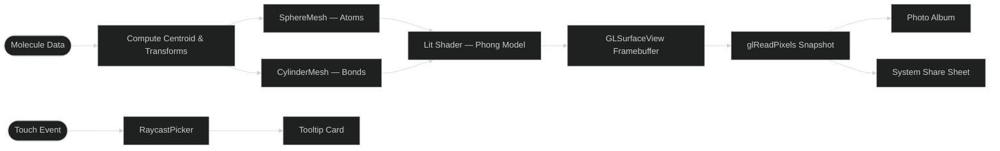

# Protein View

The **Protein View** is the central 3D visualization engine of Swifty Proteins. Powered by custom **OpenGL ES 2.0**, it renders molecular structures in three dimensions using spherical atomic geometries and cylindrical chemical bonds. Users can freely manipulate the camera using touch gestures (orbit rotation, pinch-to-zoom, pan), interact with individual atoms via 3D raycasting to reveal elemental tooltips, toggle floating atomic labels, and export or share high-resolution renderings.

## 3D Rendering Architecture



## Feature Specifications

### CPK Coloring
Atoms are shaded strictly adhering to the standard **Corey-Pauling-Koltun (CPK)** chemical color scheme defined in `Atom.kt`:

| Element | Symbol | Color | Hex Representation |
|---|---|---|---|
| **Carbon** | `C` | Dark Gray | `#909090` |
| **Hydrogen** | `H` | Pure White | `#FFFFFF` |
| **Oxygen** | `O` | Red | `#FF0D0D` |
| **Nitrogen** | `N` | Deep Blue | `#3050F8` |
| **Sulfur** | `S` | Bright Yellow | `#FFC832` |
| **Phosphorus** | `P` | Orange | `#FF8000` |
| **Chlorine / Fluorine** | `CL`, `F` | Vivid Green | `#1FF01F` |
| **Bromine** | `BR` | Dark Red | `#A62929` |
| **Iodine** | `I` | Dark Violet | `#940094` |
| **Iron** | `FE` | Brown | `#663300` |
| **Calcium** | `CA` | Light Green | `#3DFF00` |
| **Zinc / Magnesium** | `ZN`, `MG` | Slate Gray | `#7D80B0` |
| **Sodium** | `NA` | Violet | `#AB5CF2` |
| **Potassium** | `K` | Purple | `#8F40D4` |
| **Boron** | `B` | Salmon Pink | `#FFB5B5` |
| **Silicon** | `SI` | Golden Yellow | `#DAA520` |
| **Copper** | `CU` | Bronze | `#C88033` |
| **Other / Unknown** | `*` | Deep Pink | `#FF1493` |

### Ball-and-Stick Model
- **Atoms**: Rendered as tessellated 3D UV spheres (`SphereMesh.kt`, 20 stacks × 20 slices) scaled by elemental radius (`ballRadius`).
- **Chemical Bonds**: Rendered as smooth 3D cylinders (`CylinderMesh.kt`, 16 radial segments) scaled and rotated to connect adjacent atom coordinates.
- **Transformation Matrix**: A custom matrix transformation (`computeCylinderTransform`) aligns cylinders along the 3D directional vector between bonded atom centers, avoiding visual gaps.

### Atom Information & Raycast Selection
- **3D Raycasting**: Single-tapping the screen fires `RaycastPicker.pickAtom()`. The 2D screen coordinate is converted into Normalized Device Coordinates (NDC) and unprojected into world space via the inverted Model-View-Projection matrix (`Matrix.invertM(invMvpMatrix, 0, mvpMatrix, 0)`).
- **Ray-Sphere Intersection**: Calculates quadratic intersection discriminants against all atom spheres. The closest atom intersecting the camera ray is selected.
- **Interactive Tooltip Card**: Displays:
  - Element Name and Chemical Symbol (e.g., `Carbon (C)`)
  - Unique CIF Atom ID (e.g., `C12`, `O3`)
  - 3D Coordinates formatted to 3 decimal places (`X: 1.240 | Y: -0.582 | Z: 3.118`)
  - Color indicator badge matching the atom's CPK color
- **Selection Highlights**:
  - The tapped atom gains a cyan glowing selection halo (`drawAtomHighlight`).
  - All matching atoms of the same chemical element in the molecule are highlighted with a gold halo (`drawElementHighlight`).
- **Dismissal**: Tapping the close button `(✕)` or tapping empty 3D space immediately dismisses the tooltip.

### Share Functionality
- Tapping the **Share** button triggers an asynchronous framebuffer capture:
  - `GLES20.glReadPixels()` reads the active OpenGL ES 2.0 viewport into a direct byte buffer.
  - Image bytes are inverted vertically and converted to an ARGB-8888 bitmap.
- **Saved to Device Photo Album**: Automatically writes the captured PNG to the device's public `Pictures/SwiftyProteins` directory via Android's `MediaStore` API (scoped storage compliant across Android 10+).
- **System Share Sheet**: Packages the generated image via `androidx.core.content.FileProvider` and dispatches `Intent.ACTION_SEND` with rich metadata:
  ```text
  🔬 Ligand: ATP
  Formula: C10H16N5O13P3
  Structure: 47 atoms · 49 bonds

  Rendered with Swifty Proteins — RCSB PDB
  ```

### Camera and Lighting
- **Automatic Framing**: Centroid normalization offsets the molecule center to `(0, 0, 0)` and computes the bounding radius. The camera distance defaults to `boundingRadius * 3.2f`, ensuring any molecule fits comfortably in the viewport upon opening.
- **Touch Gesture Controls** (`ProteinSurfaceView.kt`):
  - **1-Finger Drag**: Smooth orbit rotation (pitch and yaw). Pitch is clamped to `[-89°, 89°]` to prevent disorientation from inverted gimbal lock.
  - **2-Finger Pinch**: Responsive zoom in and zoom out via `ScaleGestureDetector`, bounded between `1.5f` and `150.0f` units.
  - **2-Finger Drag**: Panning translation along the camera view plane (`panX`, `panY`).
  - **Reset Camera Button**: Instantly restores default center, zoom distance, and orbit angles.
- **Phong Lighting Model**: Custom GLSL vertex and fragment shaders evaluate ambient (30%), diffuse (70%), and specular reflection (shininess exponent 32.0) with an eye-space directional light source.

## Relevant Files in the Codebase

| File | Type | Description |
|---|---|---|
| [`ProteinViewerActivity.kt`](../../app/src/main/java/com/example/swiftyproteins/ui/viewer/ProteinViewerActivity.kt) | Kotlin Source | Coordinates 3D viewer lifecycle, atom selection callbacks, model switcher, and screenshot export/share. |
| [`ProteinSurfaceView.kt`](../../app/src/main/java/com/example/swiftyproteins/ui/viewer/gl/ProteinSurfaceView.kt) | Kotlin Source | Custom GLSurfaceView handling touch events, rotation, pinch-to-zoom, and tap dispatching. |
| [`ProteinRenderer.kt`](../../app/src/main/java/com/example/swiftyproteins/ui/viewer/gl/ProteinRenderer.kt) | Kotlin Source | OpenGL ES 2.0 rendering engine: matrices, Phong shaders, atom spheres, bond cylinders, highlights, and glReadPixels. |
| [`RaycastPicker.kt`](../../app/src/main/java/com/example/swiftyproteins/ui/viewer/gl/RaycastPicker.kt) | Kotlin Source | Screen-to-world raycasting and ray-sphere intersection testing for touch selection. |
| [`SphereMesh.kt`](../../app/src/main/java/com/example/swiftyproteins/ui/viewer/gl/SphereMesh.kt) | Kotlin Source | Vertex and normal buffer generator for 3D UV spheres. |
| [`CylinderMesh.kt`](../../app/src/main/java/com/example/swiftyproteins/ui/viewer/gl/CylinderMesh.kt) | Kotlin Source | Vertex and normal buffer generator for 3D cylinders. |
| [`ShaderHelper.kt`](../../app/src/main/java/com/example/swiftyproteins/ui/viewer/gl/ShaderHelper.kt) | Kotlin Source | GLSL compilation and shader program linking helper. |
| [`AtomLabelOverlay.kt`](../../app/src/main/java/com/example/swiftyproteins/ui/viewer/AtomLabelOverlay.kt) | Kotlin Source | 2D canvas overlay projecting floating CPK elemental labels above 3D atoms. |
| [`Atom.kt`](../../app/src/main/java/com/example/swiftyproteins/data/model/Atom.kt) | Kotlin Source | CPK colors, ball radii, van der Waals radii, and coordinate models. |
| [`Bond.kt`](../../app/src/main/java/com/example/swiftyproteins/data/model/Bond.kt) | Kotlin Source | Data class representing covalent connections between atom IDs. |
| [`activity_protein_viewer.xml`](../../app/src/main/res/layout/activity_protein_viewer.xml) | XML Layout | Layout combining GLSurfaceView, overlay, action buttons, and atom tooltip card. |

## Testing and Verification

### Manual Evaluation Scenarios

#### Scenario A: 3D Visualization & CPK Coloring
1. Open ligand `ATP` or `HEM` from the list.
2. Confirm the molecule renders in 3D using spheres (atoms) and cylinders (bonds).
3. Verify CPK colors:
   - Carbon = Gray
   - Hydrogen = White
   - Oxygen = Red
   - Nitrogen = Blue
   - Phosphorus = Orange
   - Sulfur = Yellow

#### Scenario B: Touch Gestures (Rotate, Zoom, Pan)
1. **Rotate**: Drag with 1 finger. Verify the molecule rotates smoothly in all directions. Confirm that pitching up/down does not cause upside-down inversion or gimbal lock.
2. **Zoom**: Pinch with 2 fingers. Verify smooth zoom-in and zoom-out without clipping errors.
3. **Pan**: Drag with 2 fingers. Verify the molecule shifts position across the screen.
4. **Reset**: Tap the **Reset Camera** button (counter-clockwise arrow icon). Verify the molecule re-centers immediately with initial zoom and rotation.

#### Scenario C: Atom Picking & Tooltip
1. Tap on an atom in the 3D model.
2. Verify that the atom is immediately selected and a glowing cyan halo surrounds it.
3. Verify that the **Atom Information Tooltip** appears displaying:
   - Element name & symbol
   - Atom ID
   - 3D coordinates (X, Y, Z)
   - Matching CPK color chip
4. Verify that other atoms of the same element glow with a gold highlight.
5. Tap empty space or the `✕` close button. Verify the tooltip closes and highlights disappear.

#### Scenario D: Share & Gallery Export
1. Tap the **Share** button in the top action bar.
2. Verify a toast appears: *"Exporting 3D snapshot..."* followed by *"Saved snapshot to Photo Album"*.
3. Verify the Android system share sheet opens displaying the rendered 3D snapshot, ligand name, chemical formula, and atom count.
4. Open the Android **Gallery** / **Photos** app. Confirm that a new image exists under `Pictures/SwiftyProteins`.

### ADB / Makefile Commands

```bash
# Pull exported 3D snapshots from device to local machine
make pull-photos

# Take a direct screenshot of the 3D viewer view
make screenshot

# Verify media store insertion on device
adb shell content query --uri content://media/external/images/media --projection _display_name:relative_path
```
