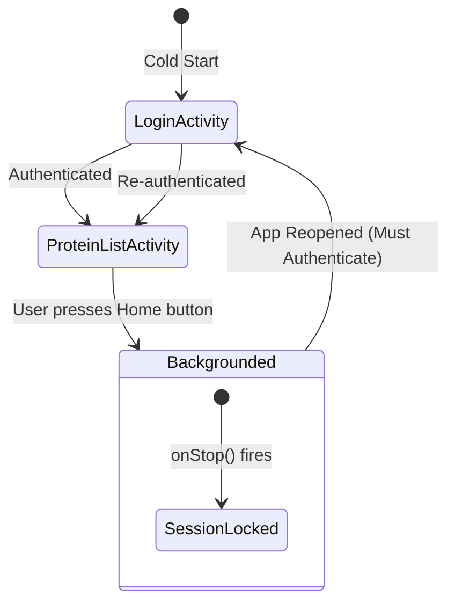

# Feature: Session Security & Background Auto-Lock

## Overview
Ensures continuous application security by enforcing automatic session locking whenever the user navigates away from the application or places it into the background.

---

## Evaluation Requirements
* **Mandatory Re-Authentication**: The application must always prompt the user to log in when accessing the app, even if they have not explicitly logged out, whenever they leave the app (e.g., returning to the home screen) and return to it.
* **Strict Evaluation Test Sequence**:
  1. Launch the application $\rightarrow$ Login View is displayed.
  2. Log in $\rightarrow$ Navigate to next view (Protein List).
  3. Press device **Home button** to background the application.
  4. Launch/reopen the application from launcher or task switcher.
  5. **Verify that the Login View is displayed**. (If the Protein List is still displayed, the test fails).

---

## Technical Specifications
* **Architecture**: Android Jetpack `LifecycleObserver` integrated with `ProcessLifecycleOwner`.
* **Components**:
  * `AppLifecycleObserver : DefaultLifecycleObserver`:
    * Listens to whole-application lifecycle events.
    * `onStop`: Triggered when the entire application moves to the background (all activities stopped). Sets `isSessionLocked = true`.
  * `SwiftyProteinsApp : Application`:
    * Application singleton registering `AppLifecycleObserver` with `ProcessLifecycleOwner.get().lifecycle.addObserver(...)`.
  * `BaseActivity` / Activity Lifecycle:
    * In `onResume()`, checks `SwiftyProteinsApp.isSessionLocked`.
    * If locked and current activity is not `LoginActivity`, clears top activities and launches `LoginActivity` with `FLAG_ACTIVITY_NEW_TASK or FLAG_ACTIVITY_CLEAR_TOP`.

---

## State Diagram

---

## Verification & Testing
1. Launch app $\rightarrow$ log in $\rightarrow$ verify `ProteinListActivity` is visible.
2. Press Home button $\rightarrow$ wait 1 second $\rightarrow$ tap Swifty Proteins app icon.
3. Confirm that the app immediately presents `LoginActivity` requiring fingerprint or password.
