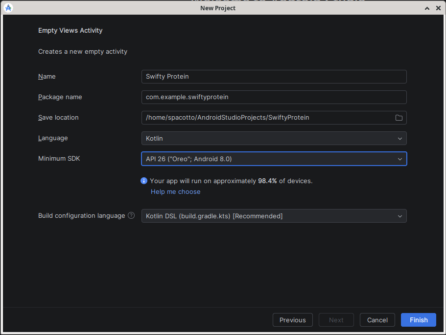

# Project Setup

## Prerequisites
* [Android Studio](https://developer.android.com/studio). For this project, `android-studio-quail4-patch1-linux.tar.gz` version was used.

## Setup
1. Create a **New Android Project**.
2. Select **Empty Views Activity** (this uses standard XML Views, making integration with 3D views like SceneView/Filament much simpler).

